<h1 align="center">SafePay</h1>

<p align="center"><b>A cash-flow-safe payables copilot for small businesses.</b><br>
An AI agent pays supplier invoices only after deterministic rules, a cash-buffer forecast and a
privacy-preserving fraud network shared across businesses all agree.</p>

<p align="center">


</p>

<p align="center">FinTechathon 2026, International Track, <b>Topic E (SME Finance Copilot)</b>.
Supplier payments are the outflow side of cash-flow management, next to cash-flow alerts, financial
analysis and financing matching.</p>

> **All data is SYNTHETIC and the bank is SIMULATED. No real money moves.** The default LLM is a
> deterministic mock; a real model is optional (`SAFEPAY_LLM=anthropic`).

## Why

An agent that can pay can be talked into paying the wrong person: an invoice with hidden instructions,
an email that "updates" a supplier's bank details, a look-alike supplier. SafePay lets the agent do the
work but never lets it decide where money goes. Every payment passes a deterministic Guardian, a 13-week
cash forecast and a blind lookup in a fraud network that other businesses feed, and the database itself
refuses anything that breaks the books.

## Screenshots

The console ships with a landing page at `/` and the operator console at `/console`, both in the same
design language (bundled fonts, no CDN). The console screenshots use synthetic sample payments served by
a mocked API for the capture; no figure in them is a measured result.

**Landing page**

<p align="center">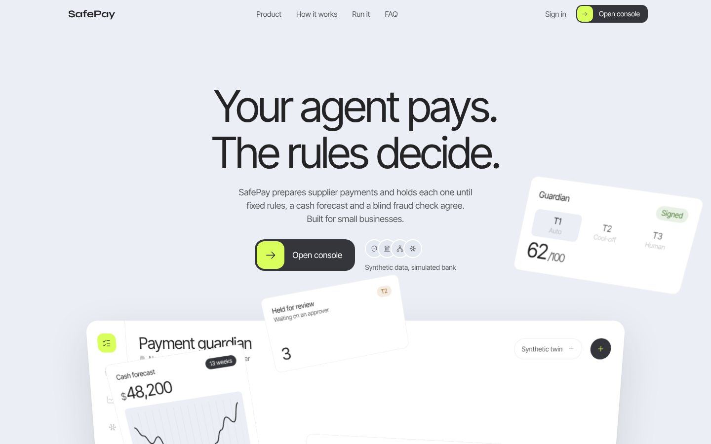</p>

<table>
<tr>
<td width="50%">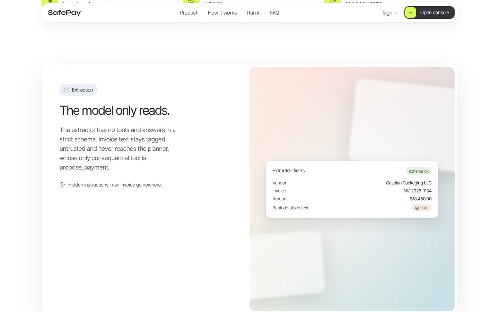</td>
<td width="50%">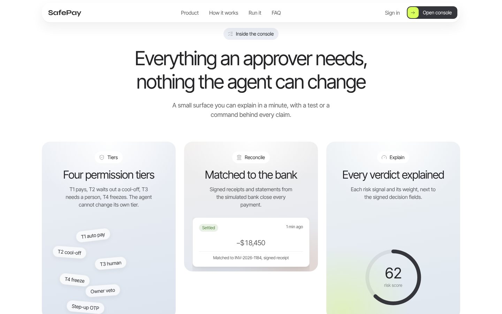</td>
</tr>
<tr>
<td>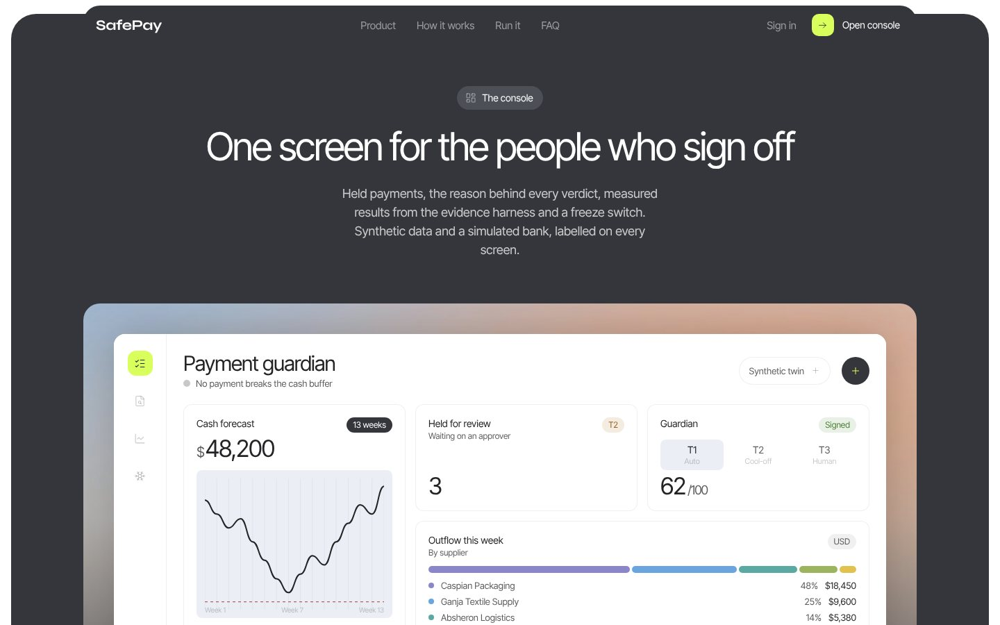</td>
<td>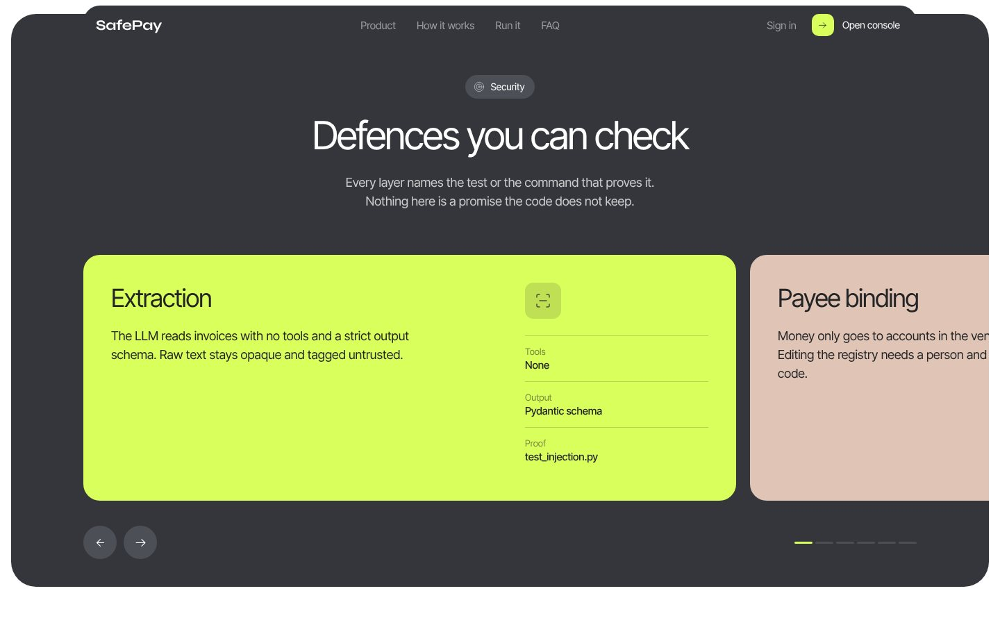</td>
</tr>
<tr>
<td>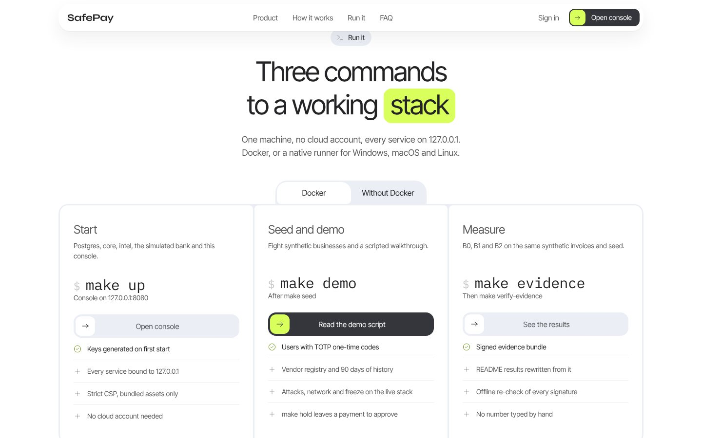</td>
<td>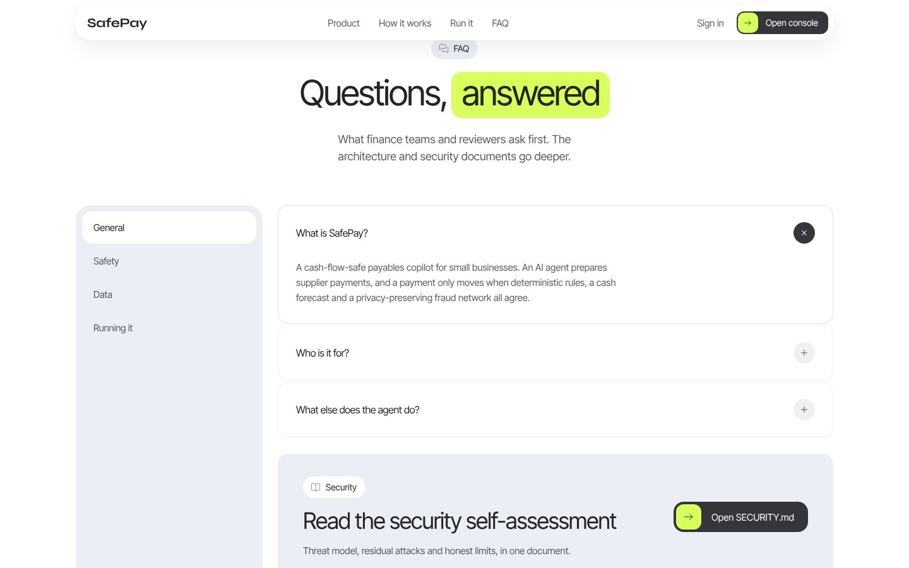</td>
</tr>
</table>

**Console**

<p align="center">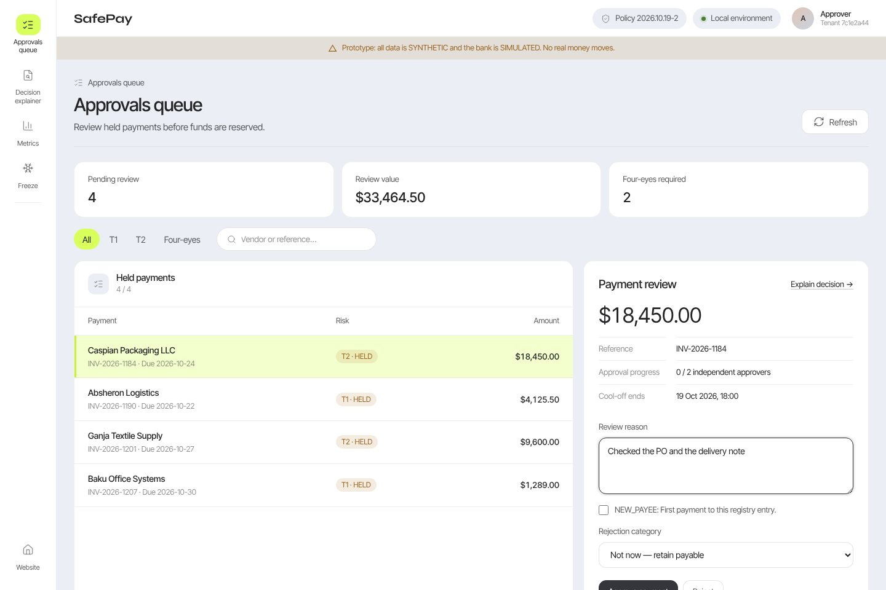</p>

<table>
<tr>
<td width="50%">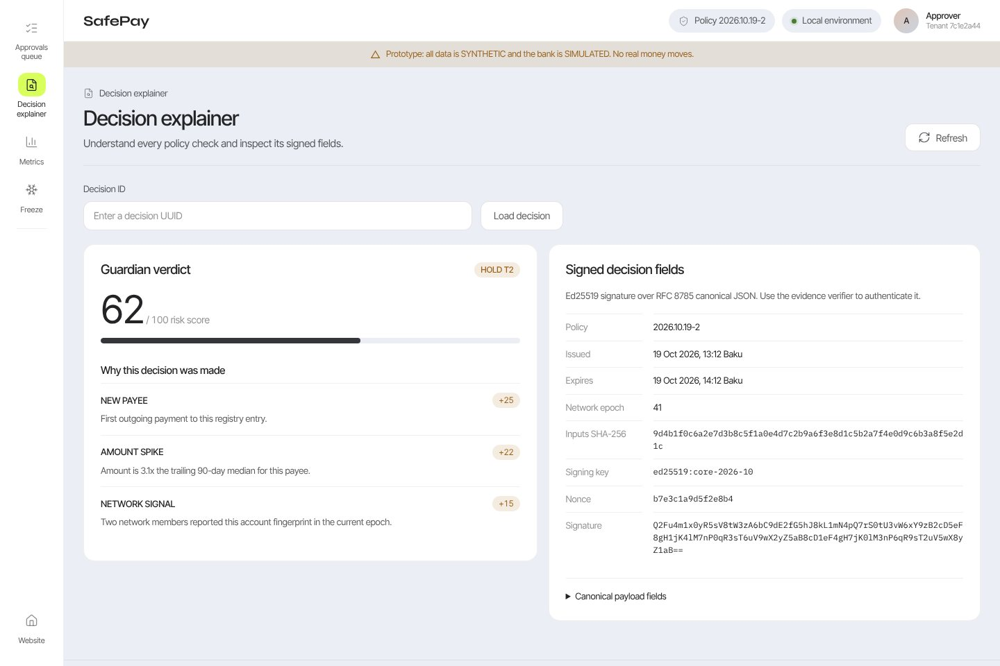</td>
<td width="50%">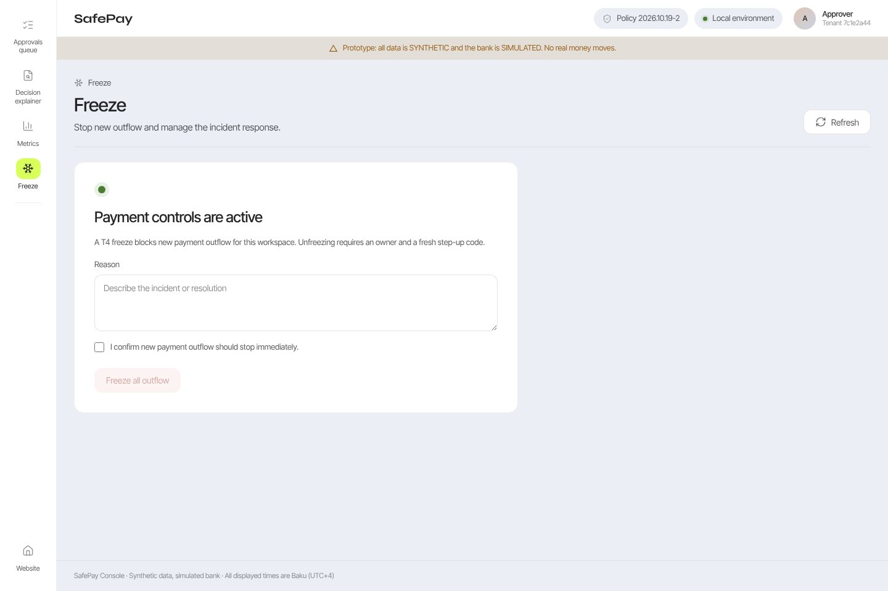</td>
</tr>
<tr>
<td>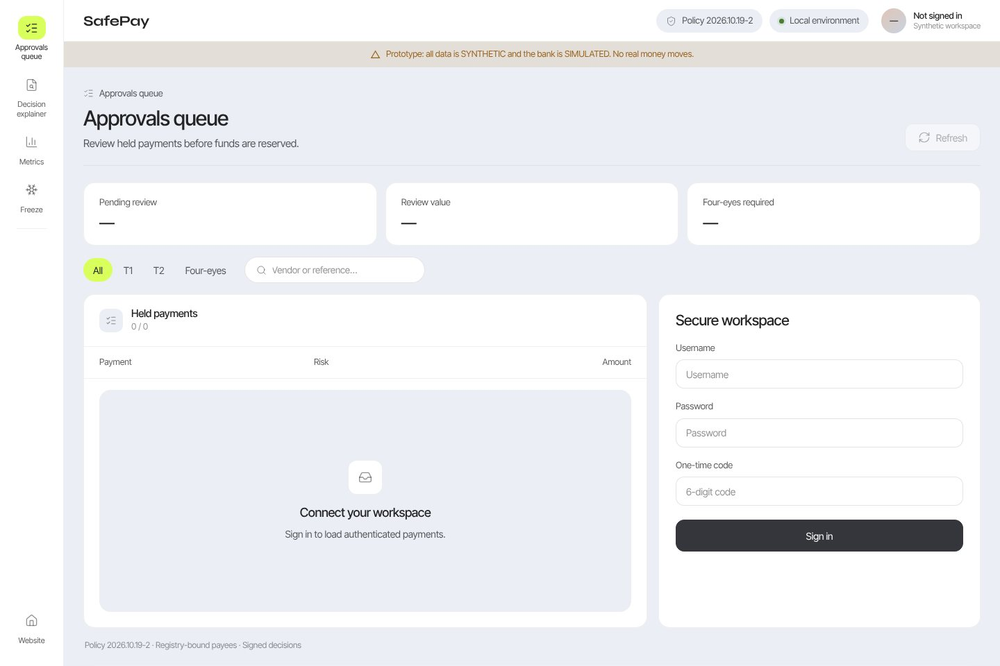</td>
<td align="center">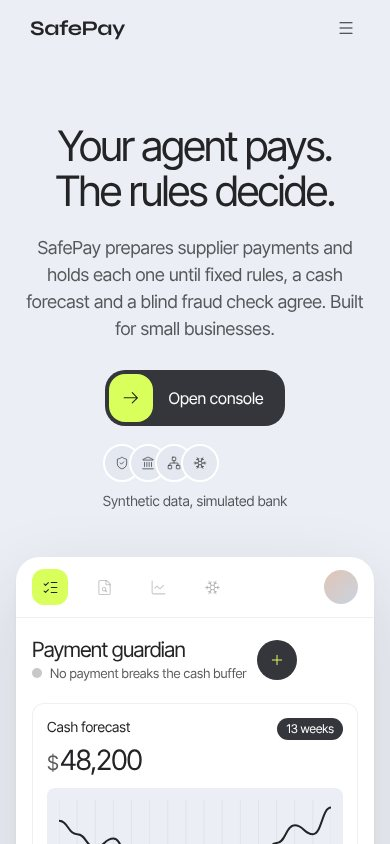 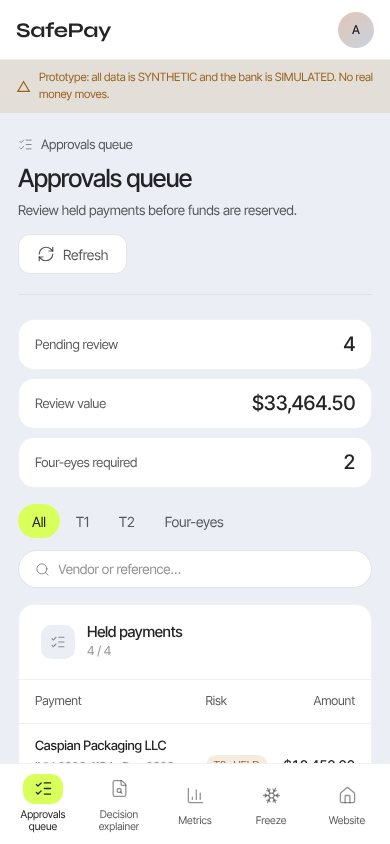</td>
</tr>
</table>

## How a payment flows

<p align="center">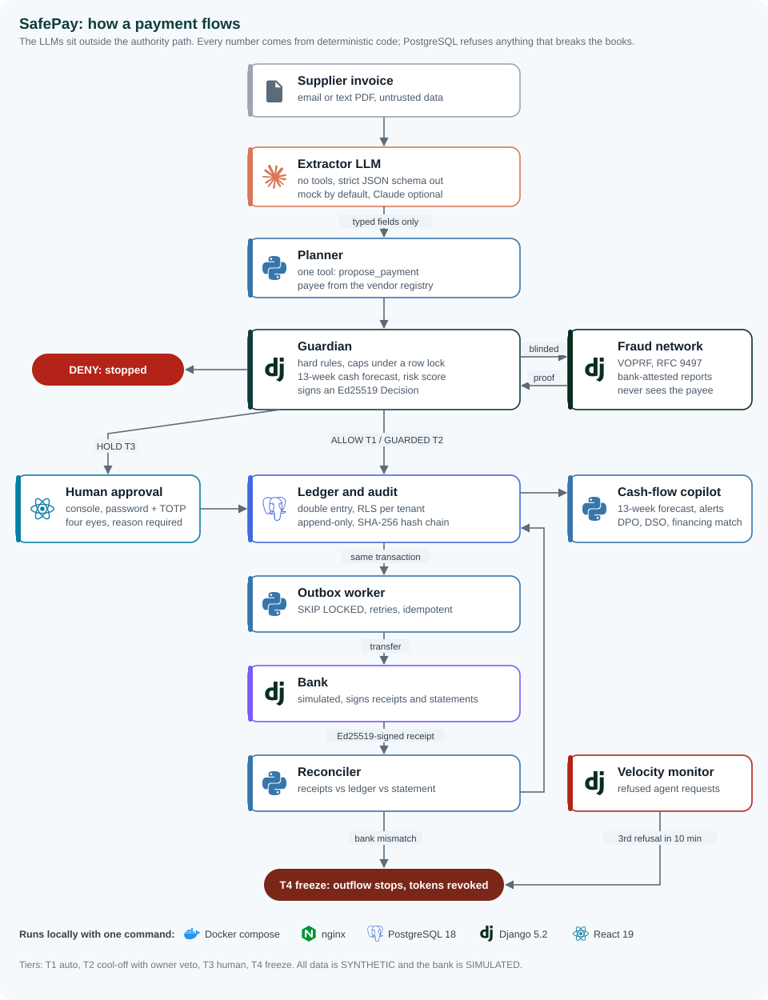</p>

| Layer | What stops the attack | Proof |
|---|---|---|
| Extraction | The LLM has no tools; its output is a strict schema; raw text stays tagged `untrusted` | `core/apps/agent/tests/test_injection.py` |
| Payee binding | The account always comes from the vendor registry, never from the invoice | same file, `make demo` steps 3 and 4 |
| Guardian | Deterministic rules, caps and a risk score; the Decision is signed and bound to the exact payment | `core/apps/guardian/tests/` |
| Tiers | T1 auto, T2 cool-off with owner veto, T3 human, T4 freeze; the agent cannot change its tier | `docs/SECURITY.md` section 2 |
| Database | Balanced entries at COMMIT, no overdraft, append-only ledger and audit, no double payment | `core/tests/test_db_roles.py`, `core/apps/ledger/tests/` |
| Fraud network | Bank-attested reports from other businesses; lookups are blind, so the operator learns nothing | `intel/tests/`, the privacy attack below |
| Freeze | A hijacked agent that keeps probing freezes its own tenant | `core/tests/test_api_flows.py` |

Details: [architecture](docs/architecture.md) and [security self-assessment](docs/SECURITY.md).

## Results

B0 is an undefended agent with direct transfer rights, B1 adds the Guardian and permission tiers, and B2
adds the fraud network. Same synthetic businesses, same invoices, same seed. This section is rewritten by
`make evidence`; no number in it is typed by hand.

<!-- results:start -->
<!-- generated by `make evidence SEED=42` from evidence/run-42/metrics.json; do not edit by hand -->

Run `run-42` (demo mode, LLM=mock, policy 2026.10.19-2). SYNTHETIC data, SIMULATED bank, deterministic mock LLM. Every number is computed from ops.jsonl of this run by safepay_sim.harness.metrics and re-checked by make verify-evidence.

| Measure | B0 | B1 | B2 |
|---|---|---|---|
| Scenarios scored / executed | 84 / 84 | 111 / 111 | 113 / 113 |
| Behaved as designed (PASS) | 84 / 84 | 111 / 111 | 113 / 113 |
| Attacker loss | USD 19,407.13 | USD 1,702.37 | USD 894.80 |
| Attack success rate | 59.0% | 7.5% | 2.4% |
| Benign task success | 100.0% | 100.0% | 100.0% |
| False holds on benign payments | 0.0% | 0.0% | 0.0% |
| Ambiguous invoices held | 100.0% | 100.0% | 100.0% |
| Decision latency p50 / p95 | not measured / not measured | 95.7 ms / 145.0 ms | 92.1 ms / 144.8 ms |

Fraud network: 2 of 2 reported-payee scenarios stopped before payment with the network (B2), 0 without it (B1).
Privacy: a network operator holding every request, every epoch key and 1,000,000 candidate IBANs recovered 0 of the 91 real payee accounts (the same attack on a plain SHA-256 lookup recovers 91).
Full report with every residual attack: `evidence/run-42/EVIDENCE.md` (generated). Re-check signatures and numbers offline with `make verify-evidence SEED=42`.

<!-- results:end -->

The agent also completes the Topic E tasks (pay invoices, schedule payables, cash-flow alerts, financial
analysis, financing match); per-task results are in `EVIDENCE.md`.

## Quickstart with Docker

```bash
make up              # build and start postgres, bank, intel, core-web, core-worker, console
make seed            # 8 synthetic SMEs: users (TOTP), vendor registry, 90 days of history
make demo            # scripted walkthrough on the live stack (payments, attacks, network, freeze)
make evidence        # B0/B1/B2 run + operator privacy attack into evidence/run-42/ (+ EVIDENCE.md)
make verify-evidence # offline re-check of every signature, the audit chains and the metrics
```

Landing page: http://127.0.0.1:8080, console: http://127.0.0.1:8080/console. Services: core :8000,
intel :8001, bank (simulated) :8002, all bound to 127.0.0.1. Secrets and keys are generated on first
start into `ops/dev-keys/` (gitignored). `make down-volumes` resets the database (and the demo users
that lived in it).

## Without Docker (Windows, macOS, Linux)

Needs uv, pnpm, GNU make and the PostgreSQL 18 server binaries (for example the EDB "binaries" zip).

```bash
uv sync --all-packages --frozen && pnpm install --frozen-lockfile
export PG_BIN=/path/to/pgsql/bin SAFEPAY_RUNNER=native
make native-init     # cluster on 127.0.0.1:55432, roles, three databases, migrations
make native-up       # bank, intel, core, worker and the console on http://127.0.0.1:5173/console
make seed && make demo && make evidence && make verify-evidence
make native-down     # stop everything (make native-reset wipes the databases)
```

## Signing in to the console

`make seed` prints the users (`<twin>.owner`, `<twin>.approver`, `<twin>.accountant`) and writes their
generated passwords and TOTP keys to `ops/dev-keys/demo/credentials.json` (dev only, gitignored). To get a
user's password and current one-time code:

```bash
cd sim && uv run python -m safepay_sim.harness otp logistics.approver --password
```

`make demo` rejects its own attack payments at the end, so run `make hold TWIN=logistics` to leave one
held payment in that company's approvals queue. The approver signs in at `/console`, opens it, reads the
decision explainer and approves or rejects with a reason. The person who issued the agent's token cannot
approve it.

## Measuring a real LLM

Every test and the evidence run use the deterministic mock. To measure a real model on the same
synthetic invoices (field accuracy, printed bank details, and whether an injection ever reaches a planner
tool argument):

```bash
export ANTHROPIC_API_KEY=...          # never committed; SAFEPAY_LLM_MODEL defaults to claude-opus-5-5
make evidence-llm                     # writes evidence/llm-anthropic-42/LLM.md
make evidence-llm PROVIDER=mock       # the mock baseline, same report format
```

## Development

```bash
make verify          # ruff + mypy (strict where it matters) + pytest (spec, RFC vectors, core, intel,
                     # bank, sim) + console lint/test
make tech-doc        # technical documentation PDF from docs/architecture.md + the run's results
make clean-clone     # fresh copy, README quickstart, demo, evidence, verify (stop the stack first)
make help            # all targets
```

CI (`.github/workflows/ci.yml`) runs `make verify`, then the Docker stack, seed, demo, evidence and both
verifiers, builds the PDF, and uploads `evidence/run-42/`. It also runs gitleaks, pip-audit and pnpm audit.

## Repository

| Path | Contents |
|---|---|
| `spec/` | Contracts: OpenAPI, JSON schemas, Guardian policy, state machine, ledger accounts, RFC test vectors |
| `core/` | Django 5.2 tenant domain: agent, Guardian, payments, ledger, cash flow, approvals, audit, keystore |
| `intel/` | Fraud network service: members, VOPRF, reports, signed snapshots, privacy attack |
| `bank_sandbox/` | Simulated bank: accounts, transfers, signed receipts and statements |
| `console/` | Vite + React + TypeScript: landing page (`/`) and console (`/console`: approvals queue, decision explainer, metrics, freeze) |
| `sim/` | Synthetic twin businesses and the B0/B1/B2 evidence harness |
| `ops/` | Docker compose, Makefile, scripts |
| `docs/` | [architecture](docs/architecture.md), [security](docs/SECURITY.md), [decisions](docs/DECISIONS.md), [deck outline](docs/DECK.md), [demo script](docs/DEMO_SCRIPT.md) |
| `evidence/` | Generated bundles only (gitignored) |

## Status and honest limits

- This version is verified with Docker on Linux (`make up` through `make clean-clone`, and the console in a
  browser). The native runner (`make native-*`) runs the same stack without Docker.
- The one attack class that still moves money is the first payment of a split to a new payee: it looks
  exactly like an ordinary first payment to a new supplier, stays under the new-payee cap and waits out
  the T2 cool-off. An owner who watches the cool-off can veto it. Every residual case is listed in
  `EVIDENCE.md`.
- The `voprf` binding is unaudited; intel checks it against the RFC 9497 vectors at every start-up.
- Keys live on the same host as the data (prototype); the keystore is built to map to a KMS or HSM.
- Full list: [docs/SECURITY.md](docs/SECURITY.md) section 7. Decisions: [docs/DECISIONS.md](docs/DECISIONS.md).

Brand icons from [Simple Icons](https://simpleicons.org) (CC0); trademarks belong to their owners.
