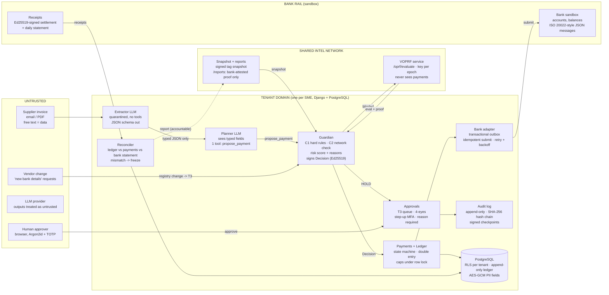
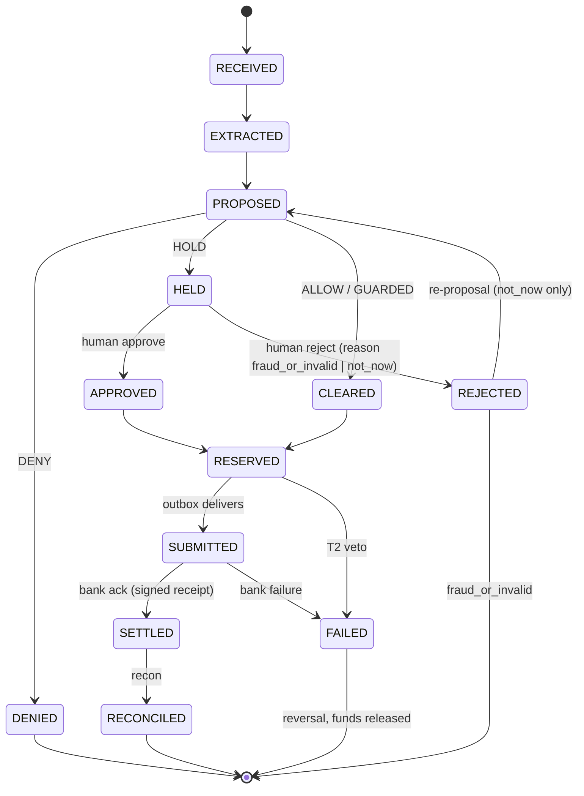
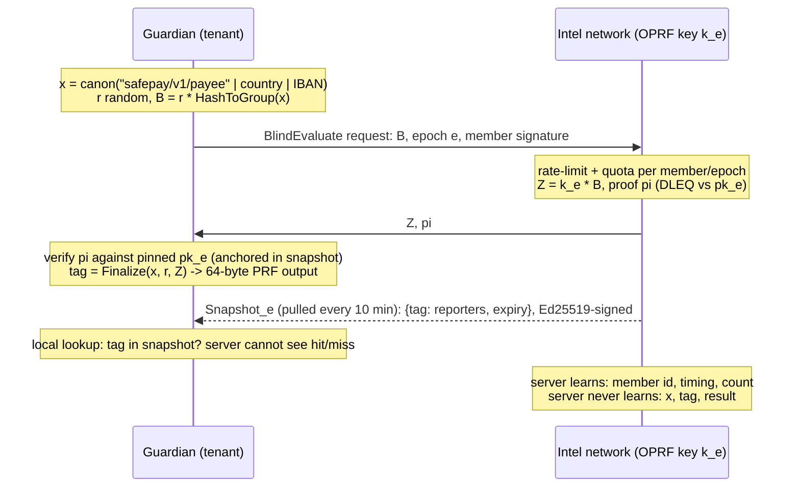

# SafePay: System Architecture, Core Algorithms, Security Design

A cash-flow-safe payables copilot for SMEs: an AI agent that pays supplier invoices only after deterministic rules, a cash-buffer forecast and a privacy-preserving cross-business fraud network agree.

FinTechathon 2026 International Track · Topic E (SME Finance Copilot) · v1.1, 19 Oct 2026 (G0 decisions applied: see DECISIONS.md D-029 to D-034)

> **Verdict: strong fit, after three changes.**
> 1. **Topic E, not F.** The mandate keeps money movement off-chain, and Topic F's gate is real on-chain hashes from an agent wallet; anchoring-only would read as off-topic. Topic E's evidence is sandbox logs, which this design produces natively.
> 2. **Reframe around Topic E's own words**: cash-flow management with alerts, financial analysis, financing matching. Payables are the outflow side of cash flow.
> 3. **Lead with the network.** A Guardian over AI-proposed payments is now table stakes (at least 7 public entries ship one; Fiona, Topic E, is nearly SafePay's Check 1). No public entry shares fraud intelligence across businesses privately. That is the lane.

---

## 0. Competition facts that constrain the design

| Item | Fact (official rules PDF, Appendix 2, unless marked) | Design consequence |
|---|---|---|
| Theme / topic | "AI as a Financial Participant". Topic E: financing-option matching, cash-flow management with alerts, business financial analysis. | Agent completes real finance tasks; payments framed as cash-flow management; deterministic forecast + financing matcher added. |
| Scoring | Task completion 40% · Security & compliance 30% · Innovation & interaction 30%; 0-5 bonus for on-chain exploration (no rubric). | Agent must finish tasks end to end with measured success; security proven by tests, not prose. Bonus not pursued (no on-chain component at all; AnchorPort dropped, D-030). |
| Evidence (E) | Simulated-account/sandbox operation logs and demo video. Reviewers read and run; no live presentation before finals. | Bank sandbox with signed receipts; evidence bundle generated and re-verified by script; MP4 shipped in package. |
| Deliverables | Tech doc; deck ≤10 min; video ≤5 min; code (README, repo, deploy, tests); security self-assessment (tiers + known risks); evidence. | This document = item 01; §3 seeds item 05; §5 defines item 06. |
| Gates | Deadline 20 Oct 23:59 UTC+8 (19:59 Baku); latest version counts. Teams of 2-5 full-time students outside Mainland China/HK/Macao/Taipei, ≥60% non-Chinese. | Submit v1 by D-12h. Confirm eligibility today (see risks). |
| Reachability | Competitor-measured: vercel.app, Google Fonts, YouTube unreliable from mainland China. | No live-URL dependency; bundled fonts; MP4 in package; one-command local run. |

---

## 1. System architecture

Four trust domains. Nothing in the untrusted domain can authorise money; the LLMs sit *outside* the authority path. The shared network is a separate service with its own database and never receives a payment proposal, which fixes the central-`/payment` privacy contradiction in the original plan.



| Component | Runtime | Responsibility | If fully compromised, worst case |
|---|---|---|---|
| Extractor LLM | core worker | Untrusted invoice to schema-validated fields. No tools, no memory. | Wrong fields; caught by registry binding, caps, 3-way checks. |
| Planner LLM | core worker | Chooses tasks; only consequential tool is `propose_payment`. | Bad proposals; bounded by Guardian + tiers. |
| Guardian | core (Django app) | Deterministic decision; signs Decision bound to exact payment fields. | Up to new-payee daily cap until freeze (T2 path). |
| Payments + Ledger | core + PostgreSQL | State machine, double entry, caps under row lock, outbox. | DB constraints still forbid overdraft and unbalanced entries. |
| Intel network | intel (Django) + own DB | VOPRF evaluation, signed snapshots, accountable reports. | False HOLDs (never blocks); learns no queried payee. |
| Bank sandbox | bank (Django) + own DB | Simulated accounts; signed receipts and statements. | Simulated only; reconciliation detects divergence. |

| Decision | Choice | Why / rejected |
|---|---|---|
| Backend | Python 3.13, Django 5.2 LTS (security support to Apr 2028), django-ninja 1.7 (pydantic, OpenAPI 3.1) | Mandated Django. 5.2 LTS over 6.1: longest support, deepest AI-model familiarity. Ninja over DRF: typed schemas double as frozen contracts. |
| Database | PostgreSQL 18, psycopg 3; one database per service with an owner role (migrations only) and a least-privilege app role (runtime: NOSUPERUSER, NOBYPASSRLS, owns nothing, SELECT/INSERT only on append-only tables); FORCE RLS on tenant tables (D-013) | Mandated. Constraints, deferrable triggers, SKIP LOCKED and RLS carry invariants the app cannot be trusted with. |
| Async work | Transactional outbox table + worker using `SELECT ... FOR UPDATE SKIP LOCKED` | No Redis/Celery: one fewer moving part, enqueue is atomic with the state change. Django Tasks has no production worker. |
| Frontend | Vite + React + TypeScript console; pnpm workspace; API client generated from OpenAPI | Mandated pnpm (pnpm-lock.yaml). Console is thin (after cuts, D-030): approvals queue, decision explainer, metrics page, freeze button. |
| Python deps | uv with uv.lock; ruff, mypy (strict on guardian, ledger, crypto), pytest, hypothesis, schemathesis | Reproducible installs; property tests for ledger invariants; contract tests from OpenAPI. |
| Packaging | docker compose: core-web, core-worker, intel, bank, postgres, console (static) | One command on a clean machine; no cloud dependency for reviewers. |

---

## 2. Core algorithms

### 2.1 Agent tasks (the 40% criterion)

| Task | Input | Deterministic core | LLM role | Success measured as |
|---|---|---|---|---|
| Pay invoice | Invoice email/PDF | Vendor-registry binding, Guardian, ledger | Extract fields; plan | Correct payee, amount, reference, due date; no loss |
| Schedule payables | Open AP + forecast | Pay on due date; early only if discount APR > hurdle | Explain choice | Discounts captured; no buffer breach |
| Cash-flow alert | Ledger, AR, AP, recurring opex | 13-week forecast, buffer test | Phrase alert | Shortfall weeks detected (precision/recall vs ground truth) |
| Financial analysis | Ledger | SQL aggregates (DPO, DSO, burn, top vendors) | Answer in plain English, numbers cited | Numeric answers match oracle exactly |
| Financing match | Projected shortfall | Rule match over synthetic catalog (amount, term, eligibility) | Explain trade-offs | Eligible option ranked first |

**Dual-LLM (CaMeL-style) separation.** The Extractor reads untrusted text and can only emit a pydantic-validated object; free-text fields (memo, notes) are passed onward as opaque, quoted data with a provenance tag `untrusted`. The Planner never sees raw invoice text. Every number the agent states is taken from a deterministic tool result, never generated. A deterministic mock LLM backs CI and the demo if the API fails.

### 2.2 Payment state machine



Each transition = one DB transaction: state row + ledger postings + audit event + outbox row. Illegal transitions raise. PROPOSED→CLEARED→RESERVED and HELD→APPROVED→RESERVED are atomic chains (one transaction). REJECTED needs a reject reason: `fraud_or_invalid` reverses the AP accrual and marks the payee reportable (final); `not_now` keeps the accrual open and the invoice may be proposed again (D-004).

**Human approval of a HOLD (D-029).** The agent caps that caused the HOLD are not re-applied (otherwise an over-cap payment could never be paid). When the final required approval arrives, one transaction under the tenant-limits row lock re-checks every hard rule and the freeze, that the payee's registry account is unchanged since the Decision (against the inputs bound by `inputs_sha256`), and that funds are available. CASH_BUFFER_BREACH is shown as a warning the approver must explicitly acknowledge. At or above `two_approver_threshold`, two distinct approvers are needed, neither of them the initiator. Human-approved amounts count toward later agent rolling-24 h totals. The audit event records approver ids, reasons and acknowledged warnings.

### 2.3 Guardian decision

```text
decide(p: Proposal) -> Decision                         # pure function + 3 reads; same inputs -> same output
  v      = registry.vendor(p.vendor_id); acct = v.verified_account          # payee NEVER from invoice text
  hard   = [PAYEE_NOT_IN_REGISTRY if p.account_id != acct.id, CURRENCY_NOT_ALLOWED, DUPLICATE_PAID,
            VENDOR_BLOCKED, TENANT_FROZEN, AMOUNT_INVALID]                  -> any => DENY
  with lock(tenant_limits[p.tenant]):                                       # SELECT ... FOR UPDATE: serialises caps
      t3 = [OVER_PER_TX_CAP, OVER_ROLLING_24H_CAP, OVER_NEW_PAYEE_CAP, CASH_BUFFER_BREACH(forecast)]
      net = intel.check(acct) if acct.is_new_or_changed(<30d) else SKIP     # VOPRF + local snapshot lookup
      if net == UNAVAILABLE: t3 += NETWORK_UNAVAILABLE                      # fail closed for new payees only
      score = min(100, sum(weight[r] for r in signals(p, inv, v, acct, net)))
      verdict = DENY if hard else HOLD if (t3 or score >= 50) else GUARDED if acct.is_new_or_changed else ALLOW
      if verdict in (ALLOW, GUARDED): reserve_funds(p)                      # same transaction as the decision
  return sign_ed25519(Decision{verdict, score, reasons, policy_version, inputs_sha256, epoch, payment fields,
                               nonce, expires=+15min})                       # single use, bound to exact fields
```

| Signal (typed reason code) | Detects | Weight |
|---|---|---|
| BANK_DETAIL_MISMATCH | Invoice shows an account different from the registry (classic invoice-redirection fraud) | +50 |
| LOOKALIKE_VENDOR / LOOKALIKE_ACCOUNT | Unicode TR39 skeleton + Damerau-Levenshtein ≤2 to an existing vendor; account sharing prefix/suffix with a known one | +50 |
| NETWORK_REPORTED_2PLUS / _1 | ≥2 distinct reporters / 1 reporter in the current snapshot | +50 / +25 |
| INJECTION_MARKERS | Instruction-like text in untrusted fields (signal only; the structural defence is 2.1) | +30 |
| DUPLICATE_SUSPECT | Same vendor and amount within 30 days, reference edit distance ≤2 | +30 |
| SPLIT_PATTERN | ≥3 payments to one payee in 24 h summing over the per-tx cap | +30 |
| AMOUNT_ANOMALY | Robust z-score (median/MAD) of amount vs this vendor's history > 3.5 | +20 |
| NEW_OR_CHANGED_PAYEE | Account first used or changed <30 days ago | +15 |

Weights and thresholds live in a versioned policy file; every Decision stores `policy_version` so any past verdict can be replayed. Network signals add risk and can force HOLD; they never DENY, so false reports cannot become a denial of service against an honest vendor.

### 2.4 Ledger posting (double entry, amounts in integer minor units)

| Event | Debit | Credit | Trigger |
|---|---|---|---|
| Invoice accepted | Expense / COGS | AP:vendor | Extraction confirmed (T0) |
| Reserve | Bank:reserved | Bank:available | Decision ALLOW/GUARDED, or human APPROVE |
| Submit | Bank:in_transit | Bank:reserved | Outbox delivers to bank adapter |
| Settle | AP:vendor | Bank:in_transit | Bank-signed receipt verified |
| Fail / veto | Bank:available | Bank:in_transit or :reserved | Bank failure or T2 veto |
| Invoice voided | AP:vendor | Expense / COGS | DENY, or REJECTED with fraud_or_invalid (a new balanced entry, never an edit) |

**Invariants enforced by PostgreSQL, not by code:** a deferred constraint trigger rejects any journal entry whose postings do not sum to zero per currency at COMMIT; `CHECK (balance >= 0)` on Bank:available makes overdraft impossible; ledger, posting, audit, decision and receipt tables are INSERT-only for the app role (UPDATE/DELETE/TRUNCATE not granted, a trigger blocks UPDATE/DELETE for every role, and the app role cannot disable it because it owns no table); `UNIQUE(tenant, invoice_fingerprint)` over live payments forbids double payment. Hypothesis property tests drive random event sequences and assert all invariants after each step.

### 2.5 Idempotency, delivery and reconciliation

| Layer | Mechanism |
|---|---|
| API | Idempotency-Key required on every creating POST; `UNIQUE(tenant, key)` storing request SHA-256 and response; replay returns the stored response, a different body returns 409. |
| Domain | `invoice_fingerprint = SHA-256(vendor_id \| normalised ref \| amount \| currency)`. Decision nonce single-use (UNIQUE). |
| Delivery | State change, ledger postings, audit event and outbox row commit together. Worker claims rows with SKIP LOCKED; at-least-once; bank dedups on `end_to_end_id` = payment UUID; retries with exponential backoff and jitter (max 6, then incident). |
| Reconcile (5 min + EOD) | Match every bank statement line to a payment by `end_to_end_id` and amount. MISSING_IN_LEDGER or AMOUNT_MISMATCH: automatic T4 freeze + incident. MISSING_IN_BANK beyond SLA: alert. Then recompute balances from postings and verify the audit chain. |

### 2.6 Cash-flow forecast and alerts

Weekly buckets for 13 weeks. Opening = ledger bank balance. Inflows = open receivables × each customer's historical on-time rate, shifted by their median delay. Outflows = scheduled AP on due dates + recurring opex (same payee, period detected over 90 days). Buffer = max(policy floor, 2 weeks of median opex). Alerts: **LOW_BUFFER** (projected < buffer), **SHORTFALL** (< 0). On SHORTFALL the scheduler proposes deferring non-critical payables (ordered by late-fee cost, then vendor criticality) and the financing matcher ranks eligible catalog products by total cost. The Guardian's CASH_BUFFER_BREACH rule uses the same forecast, so the agent cannot pay itself into a shortfall.

### 2.7 Shared fraud network: blind queries, accountable reports



| Element | Specification |
|---|---|
| Protocol | RFC 9497 VOPRF, suite ristretto255-SHA512, via the `voprf` 0.2 Python binding over Meta's Rust voprf crate, wrapped behind one port interface. CI runs the CFRG test vectors; a failure blocks merge. Verifiable mode stops the server keying clients individually to track them. |
| Input | x = "safepay/v1/payee" \| ISO country \| normalised IBAN (upper-case, no spaces, mod-97 valid). Tag truncated to 16 bytes in the snapshot (collision odds at 10^5 tags ≈ 10^-29). |
| Snapshot | Per epoch (7 days): {tag: distinct_reporters, expiry}, Ed25519-signed, pulled every 10 min. Lookup is local, so the server cannot tell a hit from a miss. |
| Report admission | Member-signed report with the payee identifier, a **bank-signed settlement receipt** proving the member actually paid that account in the last 90 days, and an evidence hash. One count per (member, payee); 30-day expiry; retraction by the reporter; reporters with upheld disputes are suspended. |
| Abuse limits | OPRF quota 500 evaluations/member/day and per-epoch key rotation bound enumeration; members are admission-controlled (KYB in production), which bounds Sybils. |
| Privacy test | Adversary gets the full server transcript and the server key plus 10^6 candidate IBANs. Pass = matching accuracy no better than chance, repeated queries for one payee unlinkable, and zero IBAN substrings in any captured client request. |

Honest scope: the server sees reported accounts and their reporters by design, because accusations need accountability. What stays private is the *query*: whom an honest business is about to pay.

---

## 3. Security design

### 3.1 Threat model

| # | Threat (OWASP LLM 2025 ref) | Control | Residual |
|---|---|---|---|
| 1 | Hidden instructions in an invoice (LLM01) | Quarantined extractor; payee from registry; deterministic Guardian | Mis-extracted amount: caps, anomaly, 3-way check |
| 2 | Bank-detail change by email (invoice redirection) | Registry change = owner + second person + call-back attestation; new account is T2/T3 + network check | Social engineering of two staff |
| 3 | Look-alike vendor or account | TR39 skeleton + edit distance; new-payee caps | Heuristic false negatives |
| 4 | Hijacked planner (LLM06 excessive agency) | Single propose tool; tiers enforced server-side and in DB | Bounded by caps |
| 5 | Stolen agent token | Scoped T0-T2, 1 h TTL, HMAC-hashed at rest, velocity freeze | ≤ rolling caps until T4 freeze |
| 6 | Insider self-approval | Initiator ≠ approver (DB CHECK); step-up MFA; two distinct approvers at or above the high cap; hard rules, payee account and funds re-checked at approval | Collusion of two |
| 7 | Double spend / race | Row lock on limits; UNIQUE fingerprint and nonce; CHECK balance ≥ 0 | None known |
| 8 | Network poisoning (false reports) | Bank-attested proof of payment; distinct reporters; expiry; never blocks | Coordinated members can force HOLDs |
| 9 | Curious network operator | VOPRF blind queries; local lookup | Sees member, time, count |
| 10 | DB exfiltration (LLM02) | AES-256-GCM envelope encryption of account data; Argon2id; RLS; encrypted backups | Keys on same host in prototype |
| 11 | Audit tampering / replay | Hash chain + signed checkpoints; single-use, field-bound, expiring Decisions and receipts | Key-holder rewrite before checkpoint export |
| 12 | Supply chain | Pinned locks (uv.lock, pnpm-lock.yaml); pip-audit, pnpm audit, gitleaks; SBOM | Zero-days in pinned deps |

### 3.2 Permission tiers (enforced by Guardian + database; the LLM cannot change them)

| Tier | Scope | Enforcement | Max loss if agent fully hijacked |
|---|---|---|---|
| T0 Read | Balances, invoices, forecast, analysis | Token scope | Data only (tenant-scoped by RLS) |
| T1 Auto | Verified payee ≥30 d, ≤ per-tx cap, within rolling-24 h cap, score <30 | Guardian + DB caps | Rolling-24 h cap, to known vendors only |
| T2 Guarded | New/changed payee, ≤ new-payee cap, clean network, score <50 | Signed Decision + cool-off (10 min demo, 4 h prod) with owner veto | New-payee daily cap |
| T3 Human | Everything else (HOLD) | Approver ≠ initiator, step-up MFA, reason required | 0 (agent can only queue) |
| T4 Emergency | Freeze agent, revoke tokens | Owner, approver, or reconciler (automatic); unfreeze owner + MFA | Stops all outflow |

Configuration (caps, roles, vendor registry) is owner-only with MFA; registry bank changes need a second person. The agent role has no write path to any of it, which is tested.

### 3.3 Authentication, keys and encryption

| Area | Decision |
|---|---|
| Passwords | argon2-cffi 25.1 as the first entry of `PASSWORD_HASHERS` (Argon2id; Django defaults time_cost 2, memory ~100 MiB, parallelism 8, tuned to ≈250 ms on target host). PBKDF2 kept second only to upgrade legacy hashes on login. Length ≥12, django-axes lockout. |
| MFA | django-otp 1.7 TOTP for all humans; step-up (fresh OTP ≤5 min) to approve, unfreeze or edit registry. Passkeys dropped (D-030). |
| Sessions | Secure, HttpOnly, SameSite=Lax cookies; CSRF on; 30 min idle / 12 h absolute for approvers; HSTS; strict CSP (bundled assets only). |
| Service auth | Agent tokens: 256-bit random, stored as HMAC-SHA256(pepper, token) (Argon2 is for low-entropy secrets). Core to intel and bank: Ed25519-signed requests with timestamp + nonce; mTLS in production. |
| Encryption | TLS 1.3 at the edge. Account numbers and contacts: AES-256-GCM per-tenant data key, wrapped by a KEK (pyca/cryptography 50); AAD = tenant \| table \| column \| row id, preventing ciphertext swaps. Searchable via HMAC blind index. No custom primitives anywhere. |
| Audit log | Append-only events; h_i = SHA-256(h_{i-1} \|\| RFC 8785 canonical JSON(event)); Ed25519-signed checkpoint every 100 events or 5 min; `make verify-audit` recomputes the chain from genesis. |

| Key | Algorithm | Holder | Prototype / production | Rotation |
|---|---|---|---|---|
| Decision signing | Ed25519 | core, per tenant | Secret file via KeyStore port / KMS-HSM | 90 d |
| Audit checkpoint | Ed25519 | core, per tenant | Same | 90 d |
| Data KEK / DEKs | AES-256-GCM | core | Env secret / KMS envelope | KEK yearly, DEK re-wrap |
| OPRF epoch key | ristretto255 scalar | intel | Secret file / HSM; threshold OPRF later | 7 d (epoch) |
| Snapshot signing | Ed25519 | intel | Secret file / KMS | 90 d, pinned in clients |
| Member request | Ed25519 | each tenant | Secret file / KMS | On demand, revocable |
| Bank attestation | Ed25519 | bank sandbox | Secret file / bank HSM | n/a (simulated) |

### 3.4 Blockchain decision

**No blockchain component at all (D-030).** No smart contract, no custody, no anchoring: the optional `AnchorPort` was cut at G0. Tamper-evidence comes from the hash-chained audit log and Ed25519-signed checkpoints, recomputed from genesis by `make verify-audit`. Rejected: any custody or limit logic in Solidity, including OpenZeppelin-based contracts (the latest OZ audit covers v5.6, by OpenZeppelin itself; the shared contracts are unaudited).

### 3.5 Compliance posture

Synthetic data only. Data minimisation: the network stores only reported accounts and reporter ids, never queries or payments. Purpose limitation and retention (reports: 30 d active, 1 y archive) follow GDPR/PIPL principles. Network flags are fraud signals, not sanctions or AML screening. Step-up MFA mirrors PSD2 strong customer authentication; registry binding mirrors Confirmation of Payee. The security self-assessment maps controls to OWASP LLM Top 10 (2025) and ASVS L2. Real deployment needs legal review of cross-business data sharing per jurisdiction.

---

## 4. Scalability, performance, reliability

| Dimension | Number / design choice |
|---|---|
| Load model | 10,000 SMEs × 40 payments/day = 400k/day ≈ 4.6/s mean, 46/s at 10× peak. One PostgreSQL 18 primary on 8 vCPU sustains well over 1,000 simple write tx/s, so the ceiling is >20× peak. |
| Contention | Caps serialise per tenant (row lock), never globally; tenants run in parallel. |
| Network | ~10% of payments hit a new payee: ~0.5 OPRF evals/s mean. Server cost is one scalar multiplication plus proof (sub-millisecond in Rust); one core serves >300/s with Python overhead. Snapshot at 10^5 tags × 24 B ≈ 2.4 MB, with deltas every 10 min. |
| Latency targets | Guardian decision p95 ≤150 ms excluding LLM; OPRF round trip ≤50 ms in-region; ledger transaction ≤20 ms; invoice to decision ≤10 s including two LLM calls. Reported only as measured by the harness (p50/p95). |
| Failure modes | Intel down: new payees HOLD, known payees continue (fail closed). LLM down: deterministic fallback or manual entry. Bank down: outbox retries, payments stay SUBMITTED, reconciliation catches up. Worker crash: SKIP LOCKED reclaims rows. |
| Durability | Prototype: nightly pg_dump. Production: WAL archiving + PITR (RPO ≤5 min, RTO ≤30 min), synchronous standby for ledger. |
| Scale path | Cells: tenants pinned to cells, each with its own Postgres. Stateless intel replicas behind the same key in an HSM; 2-of-3 threshold OPRF removes the single key holder; private information retrieval replaces full snapshots beyond ~10^7 tags. |

---

## 5. Evaluation harness and execution evidence

| Element | Specification |
|---|---|
| Digital twins | 8 synthetic SMEs (retail, construction, restaurant, logistics, ...), 90 simulated days, fixed seeds, own vendors, AR, opex and sandbox bank account. |
| Scenarios | ~60 benign (must complete), ~40 attacks across 12 classes (hidden-instruction invoice, bank-detail swap, look-alike vendor and account, duplicate and near-duplicate, split payments, reported payee, stolen-token direct API calls, self-approval, concurrent double submit, false-report poisoning, OPRF enumeration, cash-buffer breach), ~10 ambiguous (must HOLD). |
| Configurations | B0 undefended agent with direct pay rights; B1 Guardian Check 1 + tiers; B2 B1 + network. Same seeds for all three. |
| Metrics | Attacker loss per configuration; attack success rate; benign task success; false-hold rate; forecast alert precision/recall; analysis answer accuracy; network detection lift (B2 vs B1); decision latency p50/p95; privacy test result (target 0 recovered identifiers). |
| Evidence bundle | `evidence/run-<seed>/`: sandbox operation log (JSONL), decisions, bank-signed receipts and statements, audit chain + checkpoints, metrics.json, generated EVIDENCE.md and PDF. `make verify-evidence` re-checks every signature and recomputes every metric. No number in any document is typed by hand. |

---

## 6. AI implementation plan

Spec first, then parallel AI sessions along frozen interfaces. Each session receives only its spec section, the `spec/` files and its acceptance tests; it may not edit `spec/`.

```text
safepay/
  spec/                      # FROZEN at G0; single source of truth
    openapi-core.yaml  openapi-intel.yaml  openapi-bank.yaml
    schemas/       Proposal Decision Receipt Statement Report Snapshot AuditEvent EvidenceRecord (.json)
    policy.yaml    reason codes, weights, thresholds, caps      state_machine.yaml   ledger_accounts.yaml
    vectors/       CFRG RFC 9497 vectors, RFC 8785 cases, Ed25519 fixtures
  core/ safepay_core/settings/{base,test,prod}.py
        apps/ accounts tenants vendors invoices agent guardian payments ledger cashflow
              approvals audit intel_client bank_adapter recon evidence keystore
  intel/ apps/ members oprf reports snapshots          # separate Django project + DB
  bank_sandbox/                                        # separate Django project + DB
  console/  packages/api-client/                       # pnpm workspace (Vite, React, TS)
  sim/      twins scenarios attacker harness           # Python
  ops/      docker-compose.yml  Makefile (verify, demo, evidence, clean-clone)  .github/workflows/
  pyproject.toml  uv.lock  pnpm-workspace.yaml  pnpm-lock.yaml
```

### Frozen interfaces (excerpt from spec/)

| Service | Endpoint | Caller / auth | Contract |
|---|---|---|---|
| core | `POST /api/v1/agent/proposals` | Agent token (T0-T2 scope) + Idempotency-Key | Proposal in; Decision out (verdict, tier, reasons, sig) |
| core | `POST /api/v1/payments/{id}/approve` \| `reject` | Human approver, step-up OTP | Reason required; initiator cannot approve (409) |
| core | `POST /api/v1/tenants/{id}/freeze` \| `unfreeze` | Owner/approver; unfreeze owner + OTP | Idempotent; audit event |
| core | `GET /api/v1/cashflow/forecast`, `/analysis/{metric}` | Agent T0 or human | Deterministic numbers with source rows |
| intel | `POST /v1/oprf/evaluate` | Member Ed25519 signature | {epoch, blinded[]} to {evaluated[], proof}; 429 over quota |
| intel | `GET /v1/snapshots/{epoch}`, `POST /v1/reports` | Member signature | Signed snapshot; report needs bank receipt |
| bank | `POST /v1/transfers`, `GET /v1/statements?date=` | Core signature (mTLS in prod) | Idempotent on end_to_end_id; signed Receipt/Statement |

```text
Decision = { decision_id: uuid, tenant_id: uuid, verdict: ALLOW|GUARDED|HOLD|DENY, tier: T1|T2|T3,
             payment: { vendor_id, account_id, amount_minor: int64, currency: ISO-4217, invoice_fingerprint: hex },
             score: 0..100, reasons: [{ code: ReasonCode, weight: int, detail: str }], policy_version: str,
             network_epoch: int|null, inputs_sha256: hex, nonce: hex, expires_at: RFC3339, sig: ed25519/base64 }
Errors: RFC 9457 problem+json with a typed code (e.g. CAP_EXCEEDED, IDEMPOTENCY_MISMATCH, SELF_APPROVAL).
```

| Module | Owns | Consumes | Acceptance gate (must pass) |
|---|---|---|---|
| M1 ledger + payments | Accounts, postings, state machine, outbox | state_machine, ledger_accounts | Hypothesis invariants; every illegal transition raises; app role cannot UPDATE/DELETE ledger rows or disable triggers; RLS returns zero rows without app.tenant_id |
| M2 guardian | decide(), signals, policy loader, Decision signing | policy.yaml, Proposal, Decision | Table-driven tests per reason code; replay determinism |
| M3 bank sandbox | Accounts, transfers, signed receipts, statements | openapi-bank | Idempotent on end_to_end_id; signatures verify |
| M4 intel | VOPRF eval, snapshots, report admission | openapi-intel, vectors | CFRG vectors; proof-of-payment rejects forged receipts |
| M5 sim twins | Seeded data, invoices (incl. attacks) | schemas | Byte-identical output per seed |
| M6 agent | Extractor, planner, tools, mock LLM | openapi-core | Injection corpus never reaches a tool argument |
| M7 cashflow | Forecast, alerts, scheduler, financing matcher (exactly 3 synthetic products) | ledger read models | Oracle-checked forecasts on twins |
| M8 auth + approvals | Argon2id, OTP, roles, 4-eyes, freeze | openapi-core | Self-approval and stale-OTP tests fail closed |
| M9 adapter + recon | Outbox worker, retries, reconciliation | openapi-bank | Chaos test: kill worker/bank mid-run, books still balance |
| M10 harness + evidence | B0/B1/B2 runs, metrics, bundle, verifier | all schemas | verify-evidence green from a clean clone |

| Window (Baku time, re-planned at G0, D-031) | Work | Gate |
|---|---|---|
| 19 Oct 02:00-11:45 | Skeleton, compose, CI, spec; G0 decisions applied; spec frozen | G0: pipeline green, spec frozen |
| 11:45-17:30 | Parallel worktrees: M1, M2, M3, M4, M5 (docs/PARALLEL.md) | G1 by 17:30: invariants, vectors, per-rule tests pass |
| 17:30-00:30 | Parallel: M6, M7, M8, M9; intel client | G2 by 00:30: T1/T2/T3/T4 flows end to end in compose |
| 00:30-05:00 | M10 harness, console (4 views), audit verifier; first metrics | G3 by 05:00: metrics produced by script |
| 20 Oct 05:00-07:59 | Docs from generated numbers, security self-assessment, deck, video, clean-clone test | Submit v1 by 07:59 |
| 07:59-17:59 | Hardening only; re-submit | Final by 17:59 (D-2 h) |

**Cuts in effect (D-030):** AnchorPort and passkeys dropped; financing matcher limited to exactly 3 synthetic products; console limited to approvals queue, decision explainer, metrics page and freeze button. If the M4 VOPRF wrapper does not pass the CFRG vectors by 15:00, M4 switches to the documented `pyoprf` fallback (non-verifiable OPRF, disclosed as a downgrade and listed as a known risk). If G1 slips, the network ships as one reporter and one tag with the rest as roadmap.

**Rules for agents:** typed code (mypy strict in M1, M2, M4); no cryptography beyond thin wrappers over named libraries; a human reads every line of M1, M2 and the crypto wrappers; contract tests (schemathesis) generated from spec; fixed seeds; no secrets in the repo; evidence is generated, never written.

---

## 7. Known risks and out of scope

| Risk | Status / mitigation |
|---|---|
| voprf 0.2 binding is young and unaudited (the Rust core is Meta's) | Pinned; CFRG vectors in CI; behind a port so pyoprf (non-verifiable) can replace it. Not "audited crypto"; stated as such. |
| Single OPRF key holder | VOPRF stops per-client keys, not collusion or downtime; threshold OPRF is roadmap. |
| Coordinated false reports | Can force HOLDs, never losses; dispute and suspension path. |
| Keys on the same host as data | Prototype only; KeyStore port maps to KMS/HSM. |
| Topic E fit is interpretive | Rules never mention payables; mitigated by forecast, alerts, analysis and financing tasks. |
| Synthetic data, scripted attackers, simulated bank | Disclosed on every artifact; real pilot is the next step. |

Out of scope: real bank rails, card payments, multi-currency FX, OCR of scanned images (text PDFs only), mobile apps, production key ceremony, external penetration test.
